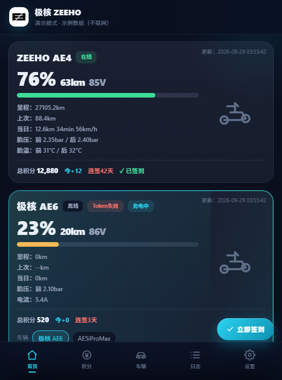
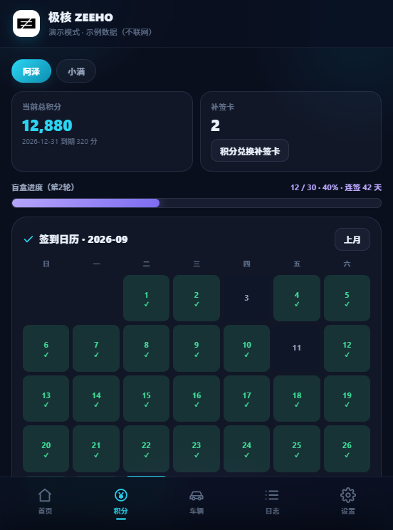
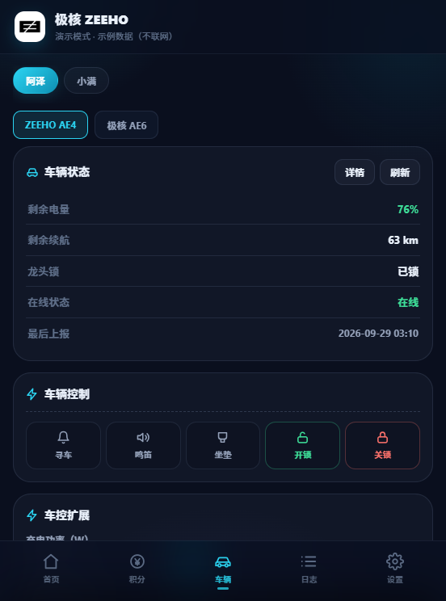
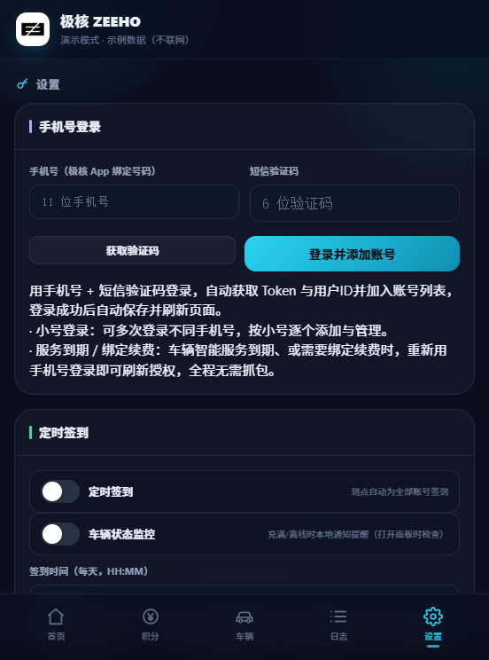
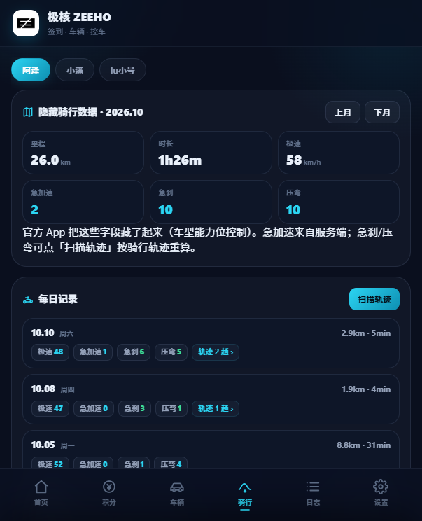
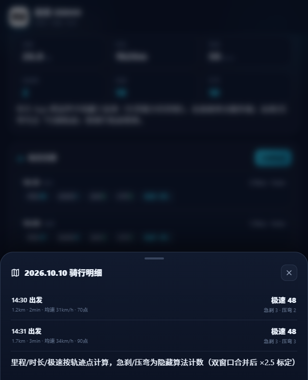

# ZEEHO
> ⚠️本项目仅用于学习研究，禁止商用，使用产生一切风险自行承担

极核ZEEHO电动车 **Loon / Quantumult X / Surge / Shadowrocket** 脚本：自动签到、社区积分任务、盲盒抽奖、车辆状态看板、远程车辆控制。HTML 可视化 BoxJS 面板，多账号管理，自动抓取 Token。另提供 **Windows 桌面版**、**Android APK**、**iOS 版（TrollStore）**、**单账号版（Android / iOS）** 与 **Scriptable 小组件脚本（单账号 / 多账号）**。

## ✨ 主要功能

### 📅 签到 & 积分任务
- 每日自动签到，统计连续签到天数（跨月连签不重置）
- 社区互动任务：发帖、点赞、评论、分享，自动清理临时动态
- 连续签到满 **30 天自动开启盲盒抽奖**
- 积分中心：积分明细、补签卡数量、签到日历、盲盒进度
- 多账号支持，账号异常**隔离运行**；签到限流自动退避重试

### 🚗 车辆状态监控（读取）
- SOC 电量、续航、电压、充电电流、充电状态
- 前后胎压、胎温、今日骑行里程/时长/最高速度
- 坐垫锁 / 整车锁 / 开关机 / 在线状态、GPS 定位 + 地图跳转、服务到期时间
- 车辆提醒（震动 / 忘关锁 / 电池拔出 / 低电量）：读取官方消息 `messageType=302`，按 messageId 去重推送
- 充电监控：充满/离线本地通知提醒（后台常驻保活）
- 后台监控：App 内每 3 分钟检查一次车辆提醒与充满/离线；进程被杀后由 30 分钟后台任务兜底

### 📱 单账号版（Android / iOS，日常推荐）
> 独立包名，可与多账号版同时安装；Android APK 与 iOS TrollStore IPA 共用同一内核
- **首页车辆卡片**：车型、在线/坐垫/车锁状态、车辆照片、前后胎压胎温、电量+续航+电压+进度条、充电时整卡赛博朋克（功率 / 剩余时间 / SOC）、定位地址
- **车控**：寻车 / 鸣笛 / 坐垫 / 开关锁（单按钮随锁状态切换），首次使用需车控风险确认
- **骑行**：轨迹回放（高德暗色底图、轨迹叠加、1/2/4 倍速、进度拖动）、分享海报（保存到相册）、骑行月报（近 6 个月趋势、急加速/急刹/压弯按轨迹重算）、最近 7 天柱状图点选
- **移车提醒**：电子围栏（中心 / 半径），移出后系统通知 + Bark 推送
- **充电统计**：本月次数 / 充入电量 / 估算电费（按充电过程记录估算，支持电价设置）；充电完成提醒（系统通知 + Bark）
- **附近充电桩**：按车辆定位搜索周边站点，分类筛选（汽车直流快充 / 交流慢充 / 交直流一体 / 50V起充直流 / 小区路边两轮），地图打点 + 距离/参考价；一键跳高德查看实时电价与空闲桩（可选填高德 Key 在面板内出列表）
- **首页模块自定义**：快捷操作 / 充电统计 / 最近骑行 的显示、隐藏与排序
- **检查更新**：设置 → 关于手动检查 + 启动自动检测，弹层显示当前/最新版本并一键下载安装包
- **启动提速**：首屏 HTML 本地缓存（脚本变更自动失效）、首帧可见即撤开屏、字节码预热延后、权限与通知延后
- **防倒卖**：社区动态按账号+日期轮换开源免费声明，账号签名静默同步开源声明
- **桌面小组件**：Android 4×3 / iOS 小·中·大 —— 车辆照片、车型、坐垫车锁、前后胎压、定位地址、电量续航电压 + 进度条、充电功率与剩余时间、签到与更新时间；App 进程不在时后台 30 分钟自动刷新

### 🏍️ 隐藏骑行数据（骑行页）
- 还原官方 App 按车型能力位隐藏的统计：**极速、急加速、急刹、压弯**
- 月度日汇总（`myRideInfo`）+ 轨迹扫描（`ridetrack_v2`）：急刹/压弯按原始轨迹重算
- 点击日期查看每趟行程明细（出发时间 / 里程 / 均速 / 极速 / 急刹 / 压弯）

### 🎛️ 远程车辆控制（4G 下发指令）
> ⚠️ 会真实操作车辆，请在车辆附近谨慎操作，误触风险自负
> 首次使用需同意「车控风险确认」弹窗
1. 🔔 寻车（闪灯）
2. 📣 鸣笛寻车
3. 💺 弹开坐垫
4. 🔒 云端开关锁
5. ⚡ 充电功率设置

### 📱 iOS 桌面小组件（WidgetKit）
- 小 / 中 / 大三种规格；单账号版使用独立 App Group（`group.com.zeeho.signpanel.single`）
- 中/大号展示车辆照片、车型、坐垫车锁、前后胎压、定位地址、电量续航电压 + 进度条、充电功率与剩余时间、签到与更新时间
- App Group 共享数据（`widget_snapshot.json` + `widget_vehicle.png`），WidgetCenter 通知刷新
- 设置页可选指定小组件显示的账号与车辆

### 🧩 Scriptable 小组件脚本（单账号版 / 多账号版）
> 免安装 App：配合 [Scriptable](https://scriptable.app) 使用，支持桌面小组件、锁屏小组件与快捷指令自动化

仓库提供两份独立脚本，功能一致（签到 / 盲盒 / 补签 / 发布 / 车控 / 充电监控 / 小组件），按需选择：

| 版本 | 文件 | 特点 |
| :-- | :-- | :-- |
| **单账号版** | [`script/Scriptable.js`](script/Scriptable.js) | 只维护一个账号，菜单精简，日常使用推荐 |
| **多账号版** | [`script/Scriptable-multi.js`](script/Scriptable-multi.js) | 多账号并存 + 并发签到，组件可按参数指定账号与车辆（`acc=账号ID&vin=车架号`） |

- 小组件：小 / 中 / 大（中尺寸显示电压）+ 锁屏圆形 / 锁屏长方形
- 自动流程：签到 → 盲盒 → 补签 → 发布动态（发布→点赞→分享→领分→删除）
- 车辆控制：寻车闪灯 / 鸣笛 / 开坐垫 / 云端开关锁（含风险确认）
- 快捷指令后台任务：`scriptable:///run/Scriptable?action=all&silent=1`（可选 `checkin` / `monitor` / `supplement`）

**使用步骤**：安装 Scriptable → 新建脚本 → 粘贴对应文件全文 → 运行一次，按菜单引导设置账号（「手机号登录」免抓包，或粘贴 Token）→ 在桌面 / 锁屏添加 Scriptable 小组件并选择该脚本。

### 🖥️ 桌面版（Windows）
- 托盘常驻、定时自动签到、开机自启
- 下载：[Releases](https://github.com/cluck798/ZEEHO/releases)（Setup 安装版 / Portable 便携版）

### 📱 iOS 版（TrollStore / 巨魔）
- WKWebView 面板 + 本地通知（签到结果、充电充满、车辆离线、充电完成、震动等车辆提醒）
- 后台常驻充电监控（静音保活 + 每 3 分钟轮询车辆提醒/充满/离线）
- BackRun.dylib 注入（延长后台运行时间，TrollStore 自动注入）
- 品牌开屏（ZEEHO logo + 加载提示，页面就绪即撤下，数据随后填充）
- 安装信息检测（巨魔/企业签/个人自签/开发者）
- 单账号版：独立包名与独立小组件，可与多账号版同时安装
- 下载：[ios-latest Release](https://github.com/cluck798/ZEEHO/releases/tag/ios-latest)（`ZeehoSignPanel.ipa` 多账号 / `ZeehoSinglePanel.ipa` 单账号），TrollStore 中点击 + 选择 IPA 安装，永久签名不掉签

### 🤖 Android 版（APK）
- 本地前台服务承载面板内核（QuickJS），支持车控、签到、小组件与后台任务
- 单账号版：独立包名，可同时安装；4×3 桌面小组件（车辆照片/车型/胎压/定位/电量进度/充电信息/签到），App 进程不在时后台 30 分钟自动刷新
- 内置抓包辅助（本地 VPN + MITM，仅拦截极核域名）与手机号登录 / 粘贴 Token
- 下载：[android-latest Release](https://github.com/cluck798/ZEEHO/releases/tag/android-latest)（`ZeehoSignPanel.apk` 多账号 / `ZeehoSinglePanel.apk` 单账号）

## 🖼️ 在线演示 & 界面预览

> **在线演示（免安装、示例数据、不联网）**：https://cluck798.github.io/ZEEHO/
>
> 也可下载仓库内的 [`demo/index.html`](demo/index.html) 直接双击打开（单文件、无依赖），支持 `?tab=home|points|vehicle|ride|logs|cfg` 直达标签页，例如 `demo/index.html?tab=vehicle`。

| 首页 | 积分 |
| :--: | :--: |
|  |  |

| 车辆 | 设置 |
| :--: | :--: |
|  |  |

| 骑行（隐藏骑行数据） | 骑行明细 |
| :--: | :--: |
|  |  |

## ⚠️ 注意事项
- 当前版本：脚本 `2.16.46` / Android `1.2.49` / iOS `1.2.50` / Windows `1.3.27`
- `boxjs_store.json` 含 Token，已被 `.gitignore` 忽略，禁止提交
- App 更新导致接口加密变化时脚本可能失效，等待适配
- 使用第三方脚本存在账号风控风险，请自行评估
- 官方 App 登录会顶掉面板 Token，需重新抓取
- LOON插件订阅：https://raw.githubusercontent.com/cluck798/ZEEHO/refs/heads/main/repo/zeeho_box_enhanced.js
- Surge模块订阅：https://raw.githubusercontent.com/cluck798/ZEEHO/refs/heads/main/modules/zeeho.sgmodule
- QX订阅：https://raw.githubusercontent.com/cluck798/ZEEHO/refs/heads/main/script/zeeho_qx.conf
- Shadowrocket配置：https://raw.githubusercontent.com/cluck798/ZEEHO/refs/heads/main/shadowrocket/zeeho.conf
- BOXJS订阅：https://raw.githubusercontent.com/cluck798/ZEEHO/refs/heads/main/script/boxjs/zeeho.boxjs.json
- 爱发电赞助：https://afdian.com/a/lucky798

## 📄 许可协议
- 本项目开源免费，仅供个人学习研究使用，**禁止任何形式的售卖、付费分发、付费代安装、捆绑销售或商业用途**
- 允许免费转发，但必须保留版权声明与作者标识（含账号资料中的开源免费声明），并注明出处 https://github.com/cluck798/ZEEHO
- 完整条款见 [LICENSE](LICENSE)；此前已按 GPLv2 发布的版本仍按 GPLv2 执行
